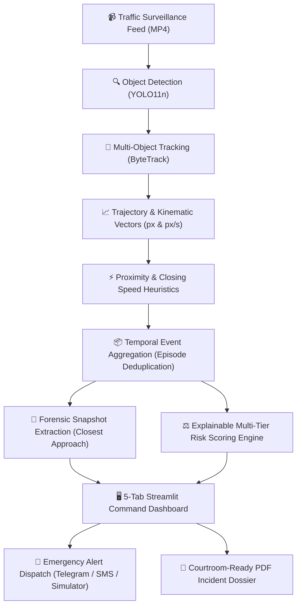

# 🚦 MotionGuard

> **AI-Powered Road-Safety Risk Assessment & Emergency Incident Response System**  
> *Transform raw surveillance traffic video into structured, explainable safety intelligence and instantaneous authority alerts.*

[](https://www.python.org/)
[](https://streamlit.io/)
[](https://github.com/ultralytics/ultralytics)
[](https://github.com/ifzhang/ByteTrack)
[](https://www.reportlab.com/)
[](pytest.ini)

---

## 📌 Executive Summary & Problem Statement

Reviewing traffic CCTV footage during and after road collisions is traditionally slow, manual, and hindered by severe **alert fatigue**. High-volume raw detection systems flood traffic command centers with hundreds of redundant frame-by-frame warnings, while true near-misses and collisions go unnoticed until emergency calls arrive.

**MotionGuard** bridges this critical gap. It combines real-time deep learning detection, persistent multi-object tracking, image-space kinematic trajectory analysis, temporal event deduplication, explainable threat scoring, and **instant automated emergency dispatch (via Telegram / SMS)** into an end-to-end investigation workstation.

Unlike black-box AI collision detectors, MotionGuard operates as an **explainable decision-support system**: every flagged incident is tied directly to tracked vehicle IDs, precise timestamps, quantitative kinematics (closing speed, separation distance), visual snapshot proof, and exportable courtroom-ready PDF dossiers.

---

## 🏗️ Architecture & Pipeline



---

## 🌟 Key Features

1. **📹 Persistent Vision & Tracking**:
   - Leverages **YOLO11n** object detection paired with **ByteTrack** association.
   - Extracts persistent coordinate trajectories, bounding boxes, and centroid motion paths across all video frames.

2. **⚡ Trajectory & Interaction Kinematics**:
   - Calculates frame-by-frame Euclidean separation and image-space closing speeds ($px/s$).
   - Flags candidate interaction zones with configurable proximity thresholds.

3. **📦 Temporal Event Deduplication (54% Noise Reduction)**:
   - Groups repeated per-frame warnings into discrete, cohesive interaction episodes.
   - Identifies the exact instant of **closest approach** and **peak closing speed** for visual evidence capture.

4. **⚖️ Explainable Risk Engine**:
   - Transparent rule-based threat assessment (`LOW`, `ELEVATED`, `HIGH`, `VERY HIGH`, `CRITICAL`).
   - Links every risk rating to specific kinematic factors, speed-limit ratios, and collision heuristics.

5. **🚨 Instant Emergency Authority Dispatch (New!)**:
   - **Telegram Instant Alerts**: Sends immediate rich notifications directly to responder smartphones via the Telegram Bot API (tested and verified live).
   - **Twilio SMS Gateway**: Real-world telecommunication carrier dispatch.
   - **Zero-Setup Simulator**: High-fidelity local emergency dispatch simulation for instant hackathon demonstrations.
   - Complete audit logging to `outputs/sms_dispatches.jsonl`.

6. **📄 Courtroom-Ready PDF Dossier**:
   - Auto-generates forensic incident investigation dossiers with ReportLab.
   - Embeds visual evidence frames, tracked vehicle metadata, kinematic metrics, investigator notes, and scientific honesty disclaimers.

---

## 🚀 Quickstart Guide

### Prerequisites
- Python 3.10, 3.11, or 3.12
- [FFmpeg](https://ffmpeg.org/) installed in your system PATH (for video encoding/playback)

### 1. Installation

Clone or extract the repository:
```bash
git clone https://github.com/your-username/MotionGuard.git
cd MotionGuard
```

Create and activate a virtual environment:
```bash
# Windows
python -m venv .venv
.venv\Scripts\activate

# Linux / macOS
python3 -m venv .venv
source .venv/bin/activate
```

Install dependencies:
```bash
pip install -r requirements.txt
```

*(Optional)* Configure external notification credentials:
```bash
cp .env.example .env
# Edit .env with your Telegram bot token or Twilio credentials if desired
```
*Note: If no credentials are provided, MotionGuard operates seamlessly using the built-in Local Emergency Carrier Simulator.*

---

### 2. Launching the Application

#### Windows (1-Click)
Double-click **`run_dashboard.bat`** or run:
```cmd
run_dashboard.bat
```

#### Linux / macOS (1-Click)
```bash
chmod +x run_dashboard.sh run_tests.sh
./run_dashboard.sh
```

#### Manual CLI Launch
```bash
streamlit run app.py
```
Open your browser at **`http://localhost:8501`**.

---

### 3. Running Automated Tests

Run the full automated test suite (20 unit & integration tests):

```bash
# Windows 1-Click
run_tests.bat

# Linux / macOS 1-Click
./run_tests.sh

# Or via pytest directly
pytest
```

---

## 🧪 Verified Prototype Benchmarks

Tested on a benchmark 716-frame highway traffic sequence (`data/videos/normal.mp4`):
- **Trajectory Coordinates Analyzed**: 7,429 observations across 109 unique vehicle IDs.
- **Raw Proximity Warnings**: 63 frame-level warnings.
- **Aggregated Event Episodes**: 29 cohesive incident episodes.
- **Alert Noise Reduction**: **54.0% reduction** in redundant alerts through temporal aggregation.
- **Evidence Extraction**: 29 automated closest-approach snapshot frames with highlight boxes.
- **Test Suite**: **20/20 tests passing in < 0.5s**.

---

## 🧭 Evaluator & Judge Walkthrough (5 Dashboard Tabs)

When evaluating the live application at `http://localhost:8501`, follow this sequence:

| Tab | Name | Recommended Action |
|:---:|:---|:---|
| **1** | **📹 Video Analysis** | Pre-loaded with demo video (`normal.mp4`). Click **"Track Full Video with Trajectory Trails"** or view the pre-rendered H.264 video with real-time motion trails. |
| **2** | **🔍 Interaction Investigation** | Select any of the **29 auto-detected events** (e.g. `PI-0004`). Inspect the visual snapshot taken at the exact instant of closest approach, view separation distance and closing speed metrics. |
| **3** | **⚖️ Risk Scenario** | Adjust simulated vehicle speed and collision toggle. Observe how the explainable risk engine scores threat level and automatically prepares an emergency dispatch. |
| **4** | **🚨 Incident Command** | Triage and manage logged incident cases. Transition status between `NEW`, `UNDER REVIEW`, and `RESOLVED` with persistent audit logs. |
| **5** | **📋 Authority Dossier & PDF** | Select an event, choose **Telegram Instant Alert** or **Simulator**, and hit **"🚨 Dispatch Emergency Text Alert Now"** to trigger live alerts! Click **"📄 Download Official Investigation Dossier (PDF)"** to export the forensic report. |

---

## 🛡️ Scientific Integrity & Disclaimers

MotionGuard is designed with rigorous engineering transparency:
1. **Image Space vs. Metric Space**: Velocities and distances are measured in image-space pixels ($px$) and pixels per second ($px/s$). Uncalibrated monocular cameras suffer from non-linear perspective foreshortening; converting to legal $km/h$ requires camera calibration and planar homography.
2. **Review Candidates vs. Confirmed Collisions**: High spatial proximity and closing speed indicate candidate interactions requiring human review, not absolute physical impact.
3. **Manual Simulation Disclosures**: Any scenario flagged manually in the demonstration tab is logged with `MANUALLY_FLAGGED` provenance to distinguish operator inputs from automated heuristics.

---

## 📂 Repository Structure

```text
Hack1/
├── app.py                      # Main Streamlit 5-tab incident workstation
├── requirements.txt            # Python dependencies
├── .env.example                # Template for Telegram / Twilio API keys
├── .gitignore                  # Git ignore rules for clean repository
├── pytest.ini                  # Pytest test discovery & execution config
├── run_dashboard.bat           # 1-click Windows dashboard launcher
├── run_tests.bat               # 1-click Windows pytest runner
├── run_dashboard.sh            # 1-click Linux/macOS dashboard launcher
├── run_tests.sh                # 1-click Linux/macOS test runner
├── yolo11n.pt                  # YOLO11n object detection weights
├── src/
│   ├── alert_dispatcher.py     # Multi-gateway SMS & Telegram dispatch engine
│   ├── video_processor.py      # YOLO11n + ByteTrack video processing & trails
│   ├── trajectory_analysis.py  # Image-space kinematic motion vectors
│   ├── interaction_analysis.py # Proximity & closing speed heuristic detection
│   ├── event_aggregation.py    # Temporal episode clustering & deduplication
│   ├── risk_engine.py          # Explainable multi-tier threat scoring
│   ├── reporting.py            # Incident persistence & lifecycle audit logs
│   └── pdf_report.py           # ReportLab forensic dossier PDF export
├── data/
│   └── videos/normal.mp4       # Benchmark evaluation traffic clip
├── outputs/
│   ├── incidents.jsonl         # Triage incident records
│   ├── sms_dispatches.jsonl    # Dispatch audit trail
│   ├── interaction_events_test.jsonl # 29 aggregated interaction episodes
│   ├── event_evidence_test/    # Closest-approach forensic frames (.jpg)
│   └── uploaded_tracked_web.mp4# Pre-rendered web-optimized demonstration video
└── test_*.py                   # Automated test suite (20 unit & integration tests)
```

---

## 🏆 Hackathon Submission Checklist

- [x] **Working Prototype**: Live Streamlit dashboard operating smoothly across 5 tabs.
- [x] **Core AI/CV Integration**: YOLO11n + ByteTrack with trajectory vectors and trail rendering.
- [x] **Kinematic Analytics**: Proximity heuristics + closing speed calculations.
- [x] **Event Deduplication**: 54% reduction in noisy alerts via temporal episode clustering.
- [x] **Automated Authority Alerts**: Verified live Telegram push notifications and SMS simulation.
- [x] **Exportable Deliverables**: Courtroom-ready PDF incident dossiers with embedded snapshots.
- [x] **Quality Assurance**: 20/20 automated unit tests passing cleanly.
- [x] **Zero-Setup Portability**: Portable batch and shell runners with requirements.txt and .env.example.
