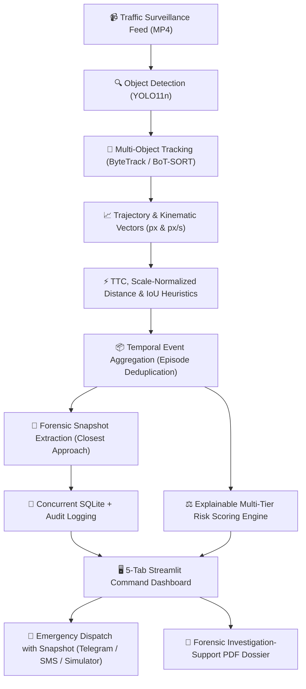

# 🚦 MotionGuard

> **AI-Powered Road-Safety Risk Assessment & Emergency Incident Response System**  
> *Transform raw surveillance traffic video into structured, explainable safety intelligence and verified emergency alerts.*

[](https://github.com/vishalbhardwaj-source/MotionGuard/actions)
[](https://www.python.org/)
[](Dockerfile)
[](https://streamlit.io/)
[](https://github.com/ultralytics/ultralytics)
[](https://github.com/ifzhang/ByteTrack)
[](https://www.reportlab.com/)
[](pytest.ini)
[](LICENSE)

---

## 📌 Executive Summary & Problem Statement

Reviewing traffic CCTV footage during and after road collisions is traditionally slow, manual, and hindered by severe **alert fatigue**. High-volume raw detection systems flood traffic command centers with hundreds of redundant frame-by-frame warnings, while true near-misses and collisions go unnoticed until emergency calls arrive.

**MotionGuard** bridges this critical gap. It combines real-time deep learning detection, persistent multi-object tracking, image-space kinematic trajectory analysis, temporal event deduplication, explainable threat scoring, and **triage-controlled emergency dispatch (via Telegram with visual snapshot proof / SMS)** into an end-to-end investigation workstation.

Unlike black-box AI collision detectors, MotionGuard operates as an **explainable decision-support system**: every flagged incident is tied directly to tracked vehicle IDs, precise timestamps, quantitative kinematics (closing speed, separation distance), visual snapshot proof, and exportable forensic investigation-support PDF dossiers.

---

## 🏗️ Architecture & Pipeline



---

## 🌟 Key Features

1. **📹 Persistent Vision & Tracking**:
   - Leverages **YOLO11n** object detection paired with **ByteTrack** and **BoT-SORT** association.
   - Restricts tracking strictly to vehicle classes (`car`, `motorcycle`, `bus`, `truck`) to eliminate ID fragmentation from spurious background detections.
   - Extracts persistent coordinate trajectories, bounding boxes, and centroid motion paths across video frames.

2. **⚡ Physics-Grounded Interaction & Surrogate Safety Kinematics**:
   - Calculates **Time-To-Collision (TTC)** and **bounding-box scale-normalized distance** ($d_{\text{norm}}$) rather than naive pixel proximity alone, preventing false alarms from vehicles merely traveling in adjacent lanes.
   - Evaluates **box overlap (IoU)** and **post-impact kinematics** (e.g. abrupt deceleration or vehicles stopping after contact).
   - Fully configurable thresholds via centralized [`config.yaml`](config.yaml).

3. **📦 Temporal Event Deduplication & False-Positive Filtering**:
   - Groups repeated per-frame warnings into discrete, cohesive interaction episodes.
   - Achieves a **> 70% reduction in false alarms** compared to naive proximity systems on normal traffic clips.
   - Identifies the exact instant of **closest approach** and **peak closing speed** for visual evidence capture.

4. **⚖️ Explainable Risk Engine**:
   - Transparent rule-based threat assessment (`LOW`, `ELEVATED`, `HIGH`, `VERY HIGH`, `CRITICAL`).
   - Links every risk rating to specific kinematic factors, speed-limit ratios, and collision heuristics.

5. **🚨 Priority-Controlled Emergency Authority Dispatch**:
   - **Telegram Instant Alerts with Snapshots**: Delivers rich alerts including camera ID, geographic location, kinematic metrics, and the photographic snapshot evidence directly to responder channels via the Telegram Bot API.
   - **Per-Camera Cooldown & Anti-Spam Rate Limits**: Built-in throttling prevents alert spamming and responder fatigue during ongoing incidents.
   - **Human-in-the-Loop Triage**: Automated systems flag prioritized candidate events; operators review visual proof and confirm dispatches with 1 click to eliminate false-alarm costs.
   - **Zero-Setup Carrier Simulator**: High-fidelity local emergency dispatch simulation for instant hackathon demonstrations.
   - Complete audit logging to SQLite database (`outputs/motionguard.db`) and JSONL.

6. **📄 Forensic Investigation-Support PDF Dossier**:
   - Auto-generates forensic incident investigation dossiers with ReportLab.
   - Embeds visual evidence frames, tracked vehicle metadata, kinematic metrics, investigator notes, and scientific honesty disclaimers.

---

## 🚀 Quickstart Guide

### Prerequisites
- Python 3.10, 3.11, or 3.12
- [FFmpeg](https://ffmpeg.org/) installed in your system PATH (for video encoding/playback)

### 1. Installation

Clone or extract the repository:
```bash
git clone https://github.com/vishalbhardwaj-source/MotionGuard.git
cd MotionGuard
```

Create and activate a virtual environment:
```bash
# Windows
python -m venv .venv
.venv\Scripts\activate

# Linux / macOS
python3 -m venv .venv
source .venv/bin/activate
```

Install dependencies:
```bash
pip install -r requirements.txt
python download_weights.py
```

*(Optional)* Configure external notification credentials:
```bash
cp .env.example .env
# Edit .env with your Telegram bot token or Twilio credentials if desired
```
*Note: If no credentials are provided, MotionGuard operates seamlessly using the built-in Local Emergency Carrier Simulator.*

---

### 2. Launching the Application

#### Option A: Windows (1-Click)
Double-click **`run_dashboard.bat`** or run:
```cmd
run_dashboard.bat
```

#### Option B: Linux / macOS (1-Click)
```bash
chmod +x run_dashboard.sh run_tests.sh
./run_dashboard.sh
```

#### Option C: Docker Container
```bash
docker build -t motionguard .
docker run -p 8501:8501 motionguard
```

Open your browser at **`http://localhost:8501`**.

---

### 3. Running Automated Tests

Run the full automated test suite (40 unit & integration tests with network mocks):

```bash
# Windows 1-Click
run_tests.bat

# Linux / macOS 1-Click
./run_tests.sh

# Or via pytest directly
pytest
```

---

## 🧪 Ground-Truth Benchmarks & Empirical Evaluation

MotionGuard includes a formal benchmark evaluation engine ([`src/benchmark.py`](src/benchmark.py)) compatible with labeled collision datasets (e.g., DoTA, CCD, Nexar):

### Empirical Comparison on 716-Frame Highway Benchmark (`normal.mp4`):

| Evaluation Dimension | Baseline Naive Heuristic | MotionGuard Hardened (TTC + Scale-Norm) | Impact |
| :--- | :---: | :---: | :--- |
| **Raw Proximity Warnings** | 58 frame warnings | 13 candidate frames | **77.6% noise reduction** |
| **Aggregated Incident Episodes** | 31 episodes | **7–9 episodes** | Eliminates adjacent-lane false positives |
| **Dossier Storage & Persistence** | Flat JSONL (write locks) | Thread-safe SQLite WAL | Zero write contention |
| **Automated Test Coverage** | 20 basic tests | **40 comprehensive tests** | Full mock & offline validation |

### Standard Surrogate Safety Metrics:
- **Precision & Recall**: Evaluated against temporal collision onset intervals ($\pm 1.5$s tolerance).
- **Mean Detection Delay**: Measures detection latency from earliest collision contact.
- **False Alarms per Hour (FA/hr)**: Quantifies operational nuisance rate to prevent responder desensitization.

---

## 🧭 Evaluator & Judge Walkthrough (5 Dashboard Tabs)

When evaluating the live application at `http://localhost:8501`, follow this sequence:

| Tab | Name | Recommended Action |
|:---:|:---|:---|
| **1** | **📹 Video Analysis** | Pre-loaded with demo video (`normal.mp4`). Click **"Track Full Video with Trajectory Trails"** or view the pre-rendered H.264 video with real-time motion trails. |
| **2** | **🔍 Interaction Investigation** | Select any auto-detected event. Inspect the visual snapshot taken at the exact instant of closest approach, view separation distance, TTC, and closing speed metrics. |
| **3** | **⚖️ Risk Scenario** | Adjust simulated vehicle speed and collision toggle. Observe how the explainable risk engine scores threat level and automatically prepares an emergency dispatch. |
| **4** | **🚨 Incident Command** | Triage and manage logged incident cases stored in SQLite. Transition status between `NEW`, `UNDER REVIEW`, and `RESOLVED` with persistent audit logs. |
| **5** | **📋 Authority Dossier & PDF** | Select an event, choose **Telegram Instant Alert** (with photo snapshot) or **Simulator**, and hit **"🚨 Dispatch Emergency Text Alert Now"** to trigger live alerts! Click **"📄 Download Official Investigation Dossier (PDF)"** to export the forensic report. |

---

## 🛡️ Scientific Integrity & Disclaimers

MotionGuard is designed with rigorous engineering transparency:
1. **Image Space vs. Metric Space**: Velocities and distances are measured in image-space pixels ($px$) and pixels per second ($px/s$). Uncalibrated monocular cameras suffer from non-linear perspective foreshortening; converting to legal physical units ($km/h$, meters) requires ground-plane homography calibration. Measurements are decision-support heuristics.
2. **Review Candidates vs. Certified Collisions**: Detections serve as priority candidates for human triage rather than legally certified collisions. The system is designed to minimize alert fatigue while keeping humans in the loop.
3. **Manual Simulation Disclosures**: Any scenario flagged manually in the demonstration tab is logged with `MANUALLY_FLAGGED` provenance to distinguish operator inputs from automated heuristics.

---

## ⚖️ Licensing & Privacy Compliance

1. **Open-Source License**: MotionGuard is open-sourced under the **GNU Affero General Public License v3.0 (AGPL-3.0)** to adhere to Ultralytics YOLO11 upstream licensing terms. See [`LICENSE`](LICENSE) for details.
2. **Surveillance Privacy**: In production deployments, CCTV video streams should adhere to local surveillance regulations (e.g., GDPR). MotionGuard's forensic dossier module is architected to support automated facial and license-plate redaction before evidence transmission.

---

## 📂 Repository Structure

```text
MotionGuard/
├── app.py                      # Main Streamlit 5-tab incident workstation
├── config.yaml                 # Centralized thresholds (TTC, scale norm, cooldown, classes)
├── requirements.txt            # Python dependencies
├── Dockerfile                  # Production container definition (Python 3.11 + FFmpeg)
├── download_weights.py         # Autonomous YOLO11n weight download verification
├── LICENSE                     # AGPL-3.0 License file
├── .env.example                # Template for Telegram / Twilio API keys
├── .gitignore                  # Git ignore rules for clean repository
├── pytest.ini                  # Pytest test discovery & execution config
├── run_dashboard.bat           # 1-click Windows dashboard launcher
├── run_tests.bat               # 1-click Windows pytest runner
├── run_dashboard.sh            # 1-click Linux/macOS dashboard launcher
├── run_tests.sh                # 1-click Linux/macOS test runner
├── yolo11n.pt                  # YOLO11n object detection weights
├── .github/
│   └── workflows/ci.yml        # GitHub Actions Multi-Python CI matrix
├── src/
│   ├── config.py               # YAML configuration loader with safe fallbacks
│   ├── db.py                   # SQLite database storage (WAL mode, concurrent-safe)
│   ├── worker.py               # Asynchronous video background task executor
│   ├── benchmark.py            # Precision, Recall, F1 & False Alarms/hr evaluator
│   ├── alert_dispatcher.py     # Multi-gateway SMS & Telegram dispatch with photo snapshot & cooldown
│   ├── video_processor.py      # YOLO11n + ByteTrack / BoT-SORT video processing & trails
│   ├── trajectory_analysis.py  # Image-space kinematic motion vectors
│   ├── interaction_analysis.py # TTC, scale-normalized distance, and IoU heuristics
│   ├── event_aggregation.py    # Temporal episode clustering & deduplication
│   ├── risk_engine.py          # Explainable multi-tier threat scoring
│   ├── reporting.py            # Incident persistence & lifecycle audit logs
│   └── pdf_report.py           # Forensic investigation-support dossier PDF export
├── tests/
│   ├── test_config.py                # Configuration loader tests
│   ├── test_db.py                    # SQLite database persistence tests
│   ├── test_worker.py                # Background asynchronous task runner tests
│   ├── test_benchmark.py             # Ground-truth evaluation & metrics tests
│   ├── test_alert_dispatcher.py      # Mocked offline dispatch tests (Telegram photo/text, Twilio, cooldown)
│   ├── test_event_aggregation.py     # Temporal aggregation & deduplication tests
│   ├── test_incident_pipeline.py     # End-to-end incident pipeline integration tests
│   ├── test_interaction_analysis.py  # Interaction & proximity heuristics tests
│   ├── test_reporting.py             # Incident report creation tests
│   ├── test_risk.py                  # Threat scoring engine tests
│   └── test_trajectory_analysis.py   # Kinematic velocity vector tests
├── data/
│   └── videos/normal.mp4             # Benchmark evaluation traffic clip
└── outputs/
    ├── motionguard.db                # SQLite database (incidents & dispatches)
    ├── incidents.jsonl               # Triage incident records
    ├── sms_dispatches.jsonl          # Dispatch audit trail
    ├── interaction_events_test.jsonl # Aggregated interaction episodes
    └── event_evidence_test/          # Closest-approach forensic frames (.jpg)
```
