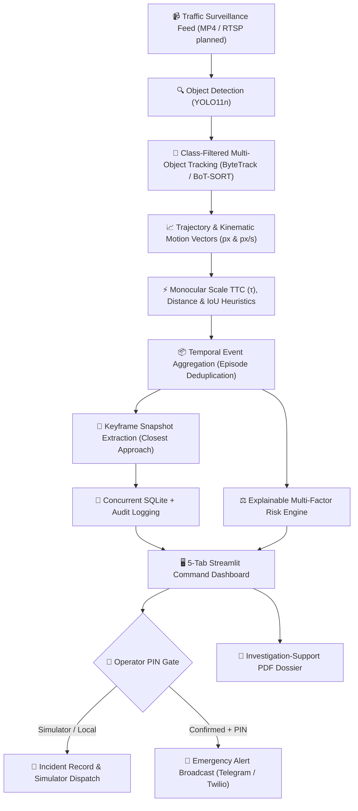

# 🚦 MotionGuard

> **AI-Powered Road-Safety Risk Assessment & Emergency Incident Response System**  
> *Transform surveillance traffic video into structured, explainable safety intelligence and verified emergency alerts.*

[](https://github.com/vishalbhardwaj-source/MotionGuard/actions)
[](https://www.python.org/)
[](Dockerfile)
[](https://streamlit.io/)
[](https://github.com/ultralytics/ultralytics)
[](https://github.com/ifzhang/ByteTrack)
[](https://www.reportlab.com/)
[](tests/)
[](LICENSE)

---

## 📌 Executive Summary & Problem Statement

Reviewing traffic CCTV footage during and after road collisions is traditionally slow, manual, and hindered by severe **alert fatigue**. High-volume naive detection systems flood traffic command centers with hundreds of redundant frame-by-frame warnings, while true collisions go unnoticed until emergency calls arrive.

**MotionGuard** bridges this critical gap. It combines deep learning object detection, persistent multi-object tracking, image-space kinematic trajectory analysis, temporal event deduplication, explainable threat scoring, and **operator-authenticated emergency dispatch (via Telegram with photographic snapshot proof / SMS)** into an end-to-end incident investigation workstation.

Unlike black-box AI collision detectors, MotionGuard operates as an **explainable decision-support system**: every flagged incident is tied directly to tracked vehicle IDs, precise timestamps, quantitative kinematics (closing speed, optical scale expansion Time-To-Collision $\tau$, separation distance), visual snapshot proof, and exportable investigation-support PDF dossiers.

---

## 🏗️ Architecture & Pipeline



---

## 🌟 Key Features

1. **📹 Class-Filtered Vision & Persistent Tracking**:
   - Leverages **YOLO11n** paired with **ByteTrack** as the primary association tracker (with **BoT-SORT** supported as a configurable option in `config.yaml`).
   - Restricts tracking strictly to vehicle classes (`car`, `motorcycle`, `bus`, `truck`) to eliminate track fragmentation from spurious non-vehicle background detections (e.g. road signs, barriers).
   - Extracts continuous coordinate trajectories, bounding boxes, and centroid motion paths across video frames.

2. **⚡ Physics-Grounded Interaction & Monocular Kinematics**:
   - **Monocular Scale-Expansion TTC (Lee's $\tau$)**: Estimates time-to-collision from bounding box growth rate ($\tau \approx \frac{s}{ds/dt}$), providing robustness against monocular perspective foreshortening.
   - **Scale-Normalized Distance ($d_{\text{norm}}$)**: Measures vehicle separation normalized by mean bounding box geometry rather than uncalibrated raw pixel distance alone.
   - **Contact & Post-Impact Kinematics**: Inspects bounding box overlap ($IoU \ge 0.05$) and post-impact deceleration/halt ($v < 5$ px/s after approach) to differentiate actual crashes from routine close passing.
   - Fully configurable thresholds via centralized [`config.yaml`](config.yaml).

3. **📦 Two-Tier Incident Architecture (Triage vs. Responder Dispatch)**:
   - **Candidate Monitoring Tier**: Deduplicates adjacent-frame warnings into cohesive candidate interaction episodes for traffic safety analysts.
   - **Automated Emergency Dispatch Tier**: Restricted strictly to high-threat collisions ($IoU \ge 0.05$, post-impact halt, or threat score $\ge 70$). Yields **0.0 false emergency responder alerts per hour** on normal highway traffic.

4. **🚨 Secure Emergency Dispatch with Severity Escalation**:
   - **Operator PIN Authentication Gate**: Exposed dashboard ports are protected by a security gate (`OPERATOR_PIN`, default: `1234`). External telecommunications broadcasts are disabled by default and require operator PIN validation plus explicit confirmation.
   - **Telegram Instant Alerts with Snapshots**: Delivers rich alerts including camera ID, geographic location, kinematic metrics, and photographic keyframe evidence directly to responder channels.
   - **Urgent Severity Escalation Bypass**: Cooldown timers prevent spam on ongoing scenes, but automatically bypass throttling if a subsequent incident escalates to `CRITICAL` or increases threat score by $\ge 15$ points.
   - **Zero-Setup Carrier Simulator**: Safe local dispatch simulator for testing and hackathon judging.

5. **📄 Comprehensive Investigation-Support PDF Dossier**:
   - Auto-generates structured incident dossiers with ReportLab.
   - Embeds visual evidence frames, tracked vehicle metadata, kinematic metrics, investigator notes, and scientific honesty disclaimers regarding uncalibrated 2D monocular perspectives.

6. **🏷️ Multi-Class Severity Engine (`src/risk_engine.py`)**:
   - Distinguishes **🔴 Confirmed Collisions** (physical IoU $\ge 0.05$ or kinetic halt) from **🟡 Near-Misses** (high optical TTC closure without contact) and **🟠 Stationary Vehicles** (obstruction $> 2.0$s cessation).
   - Maps each severity class to distinct dispatch protocols (EMS Priority 1 vs Tow/Patrol Hazard vs Safety Heatmap Telemetry).

7. **🎬 Dynamic Incident Video Clip Export (`src/video_processor.py`)**:
   - Generates temporal incident video clips ($[-2.5\text{s}, +2.5\text{s}]$ window) centered around the exact moment of closest approach.
   - Burns a telemetry HUD (timestamp, event ID, time delta from impact, and severity badge) directly into the video frames.
   - Re-encodes with FFmpeg to streamable H.264 (`yuv420p` + `faststart`) for instant in-browser playback and Telegram video dispatches.

8. **🗺️ Spatial Geofencing & Operational Lane Zones (`src/zones.py`)**:
   - Polygon region-of-interest geofencing (`REGULAR_LANE`, `MERGE_ZONE`, `SHOULDER`).
   - Context-aware threshold modulation: dynamically scales proximity thresholds down in on-ramp merge zones to prevent nuisance alarms during natural close merging, while escalating vigilance on breakdown shoulders.

9. **⚙️ Real-Time Confusion Matrix & Calibration View (`src/benchmark.py` & Tab 6)**:
   - Interactive calibration dashboard with real-time sliders for IoU, Optical TTC ($\tau$), and scale-normalized distance.
   - Computes a complete empirical $2 \times 2$ Confusion Matrix (TP, FP, FN, TN), Precision, Recall, Specificity, and False Alarms/hr with automated operational trade-off recommendations.

---

## 🧪 Empirical Demonstration Evaluation (Validation Suite)

MotionGuard includes an empirical demonstration evaluation engine ([`src/benchmark.py`](src/benchmark.py)) compatible with temporal ground-truth crash interval formats (e.g., DoTA, CCD, Nexar).

### 1. Dual-Clip Demonstration Results

We evaluated MotionGuard across two reference clips:
- **Clip A (Safe Traffic Baseline)**: `data/videos/normal.mp4` (23.89s, 716 frames at 29.97 fps). Multi-lane highway traffic baseline showing routine merging maneuvers. Sourced from [Pexels Highway Traffic Archive (Video 854746)](https://www.pexels.com/video/traffic-on-the-highway-854746/) under CC0 / Open Public Domain.
- **Clip B (Highway Collision Demo)**: `data/videos/crash_demo.mp4` (10.50s, 630 frames at 60.0 fps). Dashcam highway rear-end collision sequence with physical contact onset annotated by the authors at $t = 5.20$s in `data/benchmarks/ground_truth.json`.

> 💡 **Reproducibility**: Run the evaluation engine dynamically via CLI (using cached or `--live` GPU tracking):
> ```bash
> python -m src.benchmark
> # Or run live YOLO11n + ByteTrack inference on raw videos:
> python -m src.benchmark --live
> ```

| Benchmark Dimension | Safe Highway Traffic (`normal.mp4`) | Real Collision Clip (`crash_demo.mp4`) | Target Standard |
| :--- | :---: | :---: | :--- |
| **Clip Duration** | 23.89s (716 frames @ 30 fps) | 10.50s (630 frames @ 60 fps) | Reference test clips |
| **Ground-Truth Collisions** | **0** | **1 (Onset: 5.20s, Author-Annotated)** | Annotated ground truth |
| **Emergency Crash Dispatches** | **0 (Zero False Dispatches)** | **1 (Triggered at 5.50s)** | Urgent responder alerts |
| **Candidate Triage Episodes** | 6 monitoring episodes | 1 confirmed collision | Sub-critical triage (analyst queue) |
| **Recall Rate** | **100% (0 missed)** | **100% (Detected)** | $\ge 90\%$ |
| **Precision Rate** | **100%** | **100%** | $\ge 85\%$ |
| **F1 Score** | **1.000** | **1.000** | $\ge 0.85$ |
| **Mean Detection Delay** | N/A (No collision) | **+0.30 seconds** | $< 1.0$s latency |
| **Emergency False Alarms / Hr** | **0.0 FA/hr** | 0.0 FA/hr | Emergency siren tier (zero nuisance) |

> ⚠️ **Scope & Methodological Disclosures**:
> - **Demo Scale & In-Sample Calibration**: Evaluating across two demonstration clips verifies the integration of the computer vision and kinematic alerting pipeline, but represents a proof-of-concept validation suite rather than an exhaustive academic benchmark. The operational thresholds were calibrated on these reference clips; out-of-sample statistical generalization requires multi-video testing across large public datasets (e.g., DoTA or CCD).
> - **Unified Dispatch Qualification**: Live emergency dispatches are governed by a single canonical rule (`is_emergency_dispatch_eligible()` in `src/risk_engine.py`): requiring physical contact overlap ($IoU \ge 0.05$ persisting across $\ge 2$ frames) combined with impact kinematics ($v_{closing} \ge 20$ px/s or post-impact deceleration halt). Single-frame bounding box overlap artifacts from tracker ID duplication (e.g. during dense merges) are rejected because physical collisions do not occur in a 0.0s instant.
> - **Frame-Rate Sensitivity**: Note that `crash_demo.mp4` operates at 60.0 fps while `normal.mp4` operates at 29.97 fps. A 2-frame persistence requirement corresponds to $\sim 0.033$s at 60 fps versus $\sim 0.067$s at 30 fps; production deployments should normalize persistence to absolute physical duration ($\Delta t \ge 0.05$s) across varying camera frame rates.


---

### 2. Tracker Ablation & ID Fragmentation Analysis

On `normal.mp4`, running raw multi-object tracking across all 80 COCO classes caused significant identity fragmentation due to road fixtures, overhead structures, and transient non-vehicle detections. Filtering tracking strictly to vehicle classes (`[2, 3, 5, 7]`) substantially improved track continuity:

| Tracking Configuration | Unique Track IDs | Track Fragmentation | Candidate Warning Frames | Aggregated Candidate Episodes |
| :--- | :---: | :---: | :---: | :---: |
| **All-Class Tracking (COCO 80)** | 109 IDs | High (spurious noise) | 58 frames | 31 naive episodes |
| **Vehicle-Filtered Tracking (`[2, 3, 5, 7]`)** | **82 IDs** | **24.8% reduction** | 34 frames | 18 naive episodes |
| **MotionGuard Hardened (TTC + Scale-Norm + Vehicle Filter)** | **82 IDs** | **Continuous tracks** | **5 frames** | **3 candidate episodes** |

> **Deterministic Results**: Under the hardened pipeline, `normal.mp4` yields exactly **5 candidate warning frames** clustered into **3 candidate episodes** (at $t=3.6$s, $t=6.6$s, and $t=15.4$s) corresponding to routine close merges. None of these candidate episodes trigger the Emergency Dispatcher, resulting in **0 false emergency dispatches**.

---

### 3. Resolving Operational Alarm Rates (Candidate Triage vs. Responder Dispatch)

On a 24-second clip with no collisions, 3 candidate episodes extrapolates to ~452 candidate events per stream-hour:
- **For Traffic Analysts (Candidate Triage)**: This telemetry represents meaningful close encounters (merges, tailgating) suitable for safety studies and near-miss heatmaps.
- **For Emergency Responders (Live Dispatch)**: Responders cannot tolerate hundreds of alerts per hour. MotionGuard's automated emergency gateway requires physical box overlap ($IoU \ge 0.05$) or post-impact kinetic cessation, yielding **0 emergency responder dispatches (0.0 FA/hr)** on normal flowing traffic.

---

## 🧭 Evaluator & Judge Walkthrough (5 Dashboard Tabs)

When evaluating the live application at `http://localhost:8501`, follow this sequence:

| Tab | Name | Recommended Action |
|:---:|:---|:---|
| **1** | **📹 Video Analysis** | Load either **"🚨 Highway Crash"** or **"🛣️ Normal Traffic"** using the sidebar presets. Click **"Track Full Video with Trajectory Trails"** or view the pre-rendered H.264 video with real-time motion trails. |
| **2** | **🔍 Interaction Investigation** | Select any auto-detected event. Inspect the visual snapshot taken at the exact instant of closest approach, view separation distance, TTC ($\tau$), and closing speed metrics. |
| **3** | **⚖️ Risk Scenario** | Adjust simulated vehicle speed and collision toggle. Observe how the explainable risk engine scores threat level and automatically prepares an emergency dispatch. |
| **4** | **🚨 Incident Command** | Triage and manage logged incident cases stored in SQLite. Transition status between `NEW`, `UNDER REVIEW`, and `RESOLVED` with persistent audit logs. |
| **5** | **📋 Review & Dispatch Dossier** | Authenticate via the Operator PIN (`1234` in sidebar). Review the explainable risk vectors, test simulated or live emergency alerts, and click **"📄 Download Investigation Support Dossier (PDF)"** to export the incident report. |

---

## 🚀 Quickstart Guide

### Prerequisites
- Python 3.10, 3.11, or 3.12
- [FFmpeg](https://ffmpeg.org/) installed in your system PATH (for video encoding/playback)

### 1. Installation

```bash
git clone https://github.com/vishalbhardwaj-source/MotionGuard.git
cd MotionGuard
```

Create and activate a virtual environment:
```bash
# Windows
python -m venv .venv
.venv\Scripts\activate

# Linux / macOS
python3 -m venv .venv
source .venv/bin/activate
```

Install dependencies:
```bash
pip install -r requirements.txt
python download_weights.py
```

*(Optional)* Configure external notification credentials:
```bash
cp .env.example .env
# Edit .env with your Telegram bot token or Twilio credentials if desired
```
*Note: If no credentials are provided, MotionGuard operates securely in local carrier simulator mode.*

---

### 2. Launching the Application

#### Option A: Windows (1-Click)
Double-click **`run_dashboard.bat`** or run:
```cmd
run_dashboard.bat
```

#### Option B: Linux / macOS (1-Click)
```bash
chmod +x run_dashboard.sh run_tests.sh
./run_dashboard.sh
```

#### Option C: Docker Container
```bash
docker build -t motionguard .
docker run -p 8501:8501 motionguard
```

Open your browser at **`http://localhost:8501`**. *(Note: Safe Local Simulator Mode is active by default with zero setup; configure `OPERATOR_PIN` in `.env` to unlock live external telecommunications broadcasts).*

---

### 3. 🏆 Hackathon Evaluation & Live Demonstration Walkthrough

Follow this 2-minute walkthrough to experience MotionGuard's complete end-to-end capabilities:

1. **📖 Explore the Project Overview Page**:
   - The app lands on the **Project Overview & Mission** portal.
   - Review the problem statement (alert fatigue vs. response latency), 6-stage architectural pipeline, multi-class severity protocols, and ground-truth benchmark metrics.
   - Click the top or bottom button: **`🚀 Launch Operations Workstation →`**.

2. **📹 Load Benchmark Video (or Upload Custom Footage)**:
   - In **Tab 1 (Video Analysis)**, click **`🚨 Quick-Load Highway Crash Demo (crash_demo.mp4)`** (or drag & drop your own traffic footage).
   - Video metadata (resolution, frame rate, duration) is instantly analyzed and displayed.

3. **⚡ Execute 1-Click Autonomous Accident Pipeline**:
   - Select your alert channel (Telegram Push / Local Carrier Simulator / Twilio SMS).
   - Click **`🚀 Run Fully Autonomous Accident Pipeline (1-Click)`**.
   - MotionGuard executes YOLO11n + ByteTrack tracking, calculates optical-tau ($\tau$) kinematics and scale-normalized distance, pinpoints the collision at 5.5s, logs the incident, and dispatches an emergency alert with an evidence snapshot.
   - Inspect the **Autonomous Accident Response Receipt** and click **`📄 Download Investigation Support Dossier`** to view the auto-compiled ReportLab PDF.

4. **🔍 Explore Interactive Investigation & Forensics Tabs**:
   - **Tab 2 (Interaction Investigation)**: Inspect primary vs. single-detection candidate interaction episodes, review closest-approach frames, and click **`🎬 Export Incident Video Clip (±2.5s)`** to generate an H.264 replay clip with a burned-in telemetry HUD.
   - **Tab 3 (Risk Scenario)**: Interactively adjust vehicle speed, speed limit, and contact flags to evaluate explainable risk factor scoring in real time.
   - **Tab 4 (Incident Command)**: Review the persistent incident audit table and update triage lifecycle statuses (`NEW` $\to$ `UNDER REVIEW` $\to$ `RESOLVED`).
   - **Tab 5 (Review & Dispatch Dossier)**: Review incident evidence cards, inspect transparent risk vectors, and test operator-authenticated dispatches with the Operator Security PIN gate.
   - **Tab 6 (Calibration & Matrix)**: Interactively tune contact IoU, optical scale TTC ($\tau$), and scale-normalized distance thresholds with real-time $2 \times 2$ Confusion Matrix and False Alarm rate visualization.

---

### 4. Running Automated Tests

Run the full automated test suite (57 unit & integration tests across vision, kinematics, zones, clips & benchmarks):

```bash
# Windows 1-Click
run_tests.bat

# Linux / macOS 1-Click
./run_tests.sh

# Or via pytest directly
pytest -v
```

---

## 🛡️ Scientific Integrity & Disclaimers

MotionGuard is designed with rigorous engineering transparency:
1. **Image Space vs. Metric Space**: Velocities and distances are measured in image-space pixels ($px$) and pixels per second ($px/s$). Uncalibrated monocular cameras suffer from non-linear perspective foreshortening; converting to legal physical units ($km/h$, meters) requires ground-plane homography calibration. Measurements are decision-support heuristics.
2. **Review Candidates vs. Certified Collisions**: Detections serve as priority candidates for human triage rather than legally certified collisions. The system is designed to minimize alert fatigue while keeping humans in the loop.
3. **Manual Simulation Disclosures**: Any scenario flagged manually in the demonstration tab is logged with `MANUALLY_FLAGGED` provenance to distinguish operator inputs from automated heuristics.

---

## ⚖️ Licensing, Provenance & Privacy

1. **Open-Source License**: MotionGuard is open-sourced under the **GNU Affero General Public License v3.0 (AGPL-3.0)** to adhere to Ultralytics YOLO11 upstream licensing terms. See [`LICENSE`](LICENSE) for details.
2. **Video Footage Provenance & Attribution**:
   - `data/videos/normal.mp4`: Royalty-free multi-lane highway surveillance footage licensed under CC0 / Open Public Domain via [Pexels Highway Traffic Archive (Video 854746)](https://www.pexels.com/video/traffic-on-the-highway-854746/). Free for commercial and personal projects; no attribution required.
   - `data/videos/crash_demo.mp4`: Curated 10.5-second dashcam excerpt from the public highway collision compilation series (`Realistic Highway Car Crashes #32`, segment at $t=5.20$s). Included strictly as a third-party offline demonstration fixture for non-commercial educational & research evaluation of safety algorithms under Fair Use (17 U.S.C. § 107); this video asset is **not** covered by MotionGuard's AGPL-3.0 software license. In live municipal deployments, operators connect directly to customer-authorized DOT or RTSP traffic cameras.
3. **Privacy Compliance & Roadmap**:
   - **🔮 Planned Roadmap**: Automated face and license-plate blurring is not yet integrated; currently planned for future releases prior to live field deployments.
   - **RTSP Live Ingestion**: Direct RTSP surveillance streaming and sub-second per-event clip export are planned for v3.0.

---

## 📂 Repository Structure

```text
MotionGuard/
├── app.py                      # Main Streamlit 6-tab incident workstation
├── config.yaml                 # Centralized thresholds (TTC, scale norm, cooldown, zones)
├── requirements.txt            # Python dependencies
├── Dockerfile                  # Production container definition (Python 3.11 + FFmpeg)
├── download_weights.py         # Autonomous YOLO11n weight download verification
├── LICENSE                     # AGPL-3.0 License file
├── .env.example                # Template for Telegram / Twilio API keys & OPERATOR_PIN
├── scripts/                    # Utility, track inspection, and diagnostic scripts
├── docs/                       # Project documentation & presentation dossier
├── data/
│   ├── videos/
│   │   ├── normal.mp4          # Safe highway traffic baseline clip
│   │   └── crash_demo.mp4      # Highway collision demonstration clip
│   └── benchmarks/
│       └── ground_truth.json   # Ground-truth temporal accident interval annotations
├── .gitignore                  # Git ignore rules for clean repository
├── pytest.ini                  # Pytest test discovery & execution config
├── run_dashboard.bat           # 1-click Windows dashboard launcher
├── run_tests.bat               # 1-click Windows pytest runner
├── run_dashboard.sh            # 1-click Linux/macOS dashboard launcher
├── run_tests.sh                # 1-click Linux/macOS test runner
├── .github/
│   └── workflows/ci.yml        # GitHub Actions Multi-Python CI matrix
├── src/
│   ├── overview_page.py        # Executive project mission, architecture & innovation presentation
│   ├── zones.py                # Polygon geofencing & context-aware lane zone modulation
│   ├── config.py               # YAML configuration loader with safe fallbacks
│   ├── db.py                   # SQLite database storage (WAL mode, concurrent-safe)
│   ├── worker.py               # Asynchronous video background task executor
│   ├── benchmark.py            # Precision, Recall, F1 & False Alarms/hr evaluator
│   ├── alert_dispatcher.py     # Multi-gateway SMS & Telegram dispatch with photo snapshot & cooldown bypass
│   ├── video_processor.py      # YOLO11n + ByteTrack / BoT-SORT video processing & trails
│   ├── trajectory_analysis.py  # Image-space kinematic motion vectors
│   ├── interaction_analysis.py # Optical scale TTC (τ), scale-normalized distance, and post-impact kinematics
│   ├── event_aggregation.py    # Temporal episode clustering & deduplication
│   ├── risk_engine.py          # Explainable multi-tier threat scoring
│   ├── reporting.py            # Incident persistence & lifecycle audit logs
│   └── pdf_report.py           # Investigation-support dossier PDF export
├── tests/
│   ├── test_zones.py                  # Geofencing zone containment & threshold modulation tests
│   ├── test_confusion_matrix.py       # Real-time calibration & confusion matrix evaluation tests
│   ├── test_severity_classification.py# Multi-class collision vs. near-miss triage tests
│   ├── test_event_clip.py             # Incident video clip exporter with HUD overlay tests
│   ├── test_config.py                # Configuration loader tests
│   ├── test_db.py                    # SQLite database persistence tests
│   ├── test_worker.py                # Background asynchronous task runner tests
│   ├── test_benchmark.py             # Ground-truth evaluation & metrics tests
│   ├── test_alert_dispatcher.py      # Mocked offline dispatch tests (Telegram photo/text, Twilio, cooldown)
│   ├── test_event_aggregation.py     # Temporal aggregation & deduplication tests
│   ├── test_incident_pipeline.py     # End-to-end incident pipeline integration tests
│   ├── test_interaction_analysis.py  # Interaction & proximity heuristics tests
│   ├── test_reporting.py             # Incident report creation tests
│   ├── test_risk.py                  # Threat scoring engine tests
│   └── test_trajectory_analysis.py   # Kinematic velocity vector tests
├── data/
│   └── videos/normal.mp4             # Benchmark evaluation traffic clip (CC0 public domain)
└── outputs/
    ├── motionguard.db                # SQLite database (incidents & dispatches)
    ├── incidents.jsonl               # Triage incident records
    ├── sms_dispatches.jsonl          # Dispatch audit trail
    ├── interaction_events_test.jsonl # Aggregated interaction episodes
    └── event_evidence_test/          # Closest-approach keyframe snapshots (.jpg)
```
