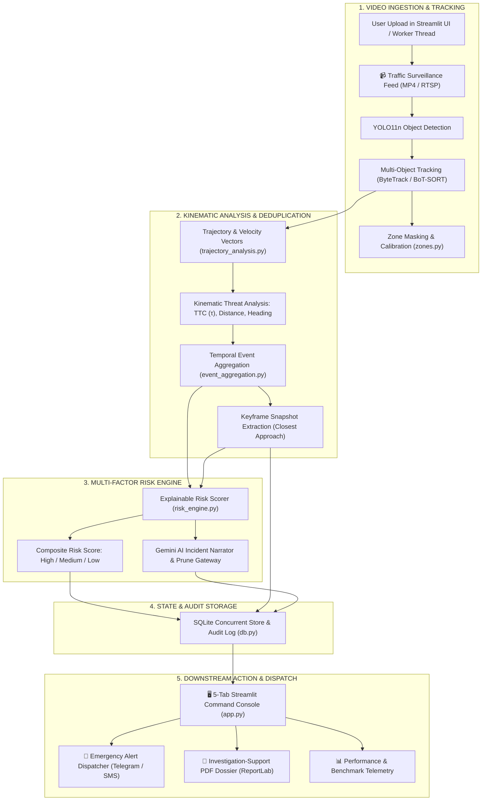

# MotionGuard (`Hack1`): End-to-End Feature Workflows

This document maps out **how each major feature in MotionGuard is initiated**, the internal processing pipelines it triggers, and **where it leads** (emergency response, command center intelligence, and investigation dossiers).

---

## High-Level System Architecture & Flow

---

## Feature 1: Video Ingestion & Persistent Multi-Object Tracking

### 1. How It Is Initiated
- **User Trigger:** Operator uploads a surveillance video (`.mp4`, `.avi`, `.mov`) or selects a sample test feed in Tab 1 ("Video Ingestion") of the Streamlit dashboard (`app.py`).
- **Headless / Batch Trigger:** Background worker process (`worker.py`) picks up incoming camera RTSP streams or files.

### 2. Processing Pipeline
1. **Frame Extraction & Preprocessing:** Streamlined frame buffering and resolution downscaling (`video_processor.py`).
2. **Deep Learning Detection:** `YOLO11n` model identifies traffic entities: vehicles, trucks, buses, motorcycles, pedestrians, and cyclists.
3. **Multi-Object Association:**
   - **ByteTrack / BoT-SORT:** Assigns consistent, persistent track IDs across frames even through temporary occlusions or visual crossing.
4. **Spatial Zone Assignment:** Checks if bounding boxes intersect defined high-risk zones, intersections, or pedestrian crosswalks (`zones.py`).

### 3. Where It Leads
- Emits smooth per-frame track coordinates $(x, y, w, h)$, velocity vectors, and zone memberships.
- Feeds continuous motion data into **Feature 2: Kinematic Interaction Analysis**.

---

## Feature 2: Kinematic Interaction Analysis & Episode Deduplication

### 1. How It Is Initiated
- **Automated Pipeline Trigger:** Continuously triggered as tracked objects move through the frame (`interaction_analysis.py`, `trajectory_analysis.py`).

### 2. Processing Pipeline
1. **Pairwise Spatial Filtering:** Discards distant or parallel moving vehicles to maintain 30+ FPS throughput.
2. **Kinematic Threat Heuristics:**
   - **Closing Speed:** Computes relative rate of approach between bounding box centers.
   - **Optical Scale Time-To-Collision ($\tau$):** Measures the rate of expansion of vehicle size in monocular image space without requiring LiDAR depth sensors.
   - **Trajectory Intersections:** Evaluates heading angles for sudden deviations, illegal turns, or erratic braking.
3. **Temporal Episode Aggregation (`event_aggregation.py`):**
   - Naive detectors trigger alert fatigue by firing 60+ alarms for a 2-second crash.
   - Aggregates multiple frame-level warnings within a sliding time window (e.g. 2.0s) into a **single consolidated incident record**.
4. **Keyframe Snapshot Preservation:** Identifies and crops the exact millisecond of closest approach / maximum impact.

### 3. Where It Leads
- Produces a single, deduplicated **Incident Candidate** containing keyframe proof, tracked vehicle IDs, duration, and kinematic measurements.
- Forwards candidate to **Feature 3: Multi-Factor Risk Engine**.

---

## Feature 3: Multi-Factor Threat Engine & AI Narrative Generation

### 1. How It Is Initiated
- **Automated Pipeline Trigger:** Triggered immediately when an incident episode closes (`risk_engine.py`, `incident_pipeline.py`).

### 2. Processing Pipeline
1. **Multi-Factor Risk Scoring:**
   Computes a transparent composite risk score based on:
   - Severity of decelerations / acceleration shocks.
   - Optical scale TTC $\tau$ threshold breach ($< 1.2\text{s}$).
   - Vulnerable road user involvement (pedestrians, bicycles).
   - High-risk zone multipliers (e.g., school zone, busy junction).
2. **Severity Classification:**
   - 🔴 **HIGH SEVERITY:** Probable collision or acute near-miss requiring immediate dispatch.
   - 🟡 **MEDIUM SEVERITY:** Reckless lane change, abrupt braking, or close near-miss.
   - 🟢 **LOW / MONITOR:** Minor traffic flow irregularity.
3. **Gemini AI Safety Assistant (`gemini_service.py`):**
   - Synthesizes human-readable incident summaries explaining what transpired.
   - Operates behind a **Prune Gateway (`prune_gateway.py`)** to ensure safety validation and prevent hallucinations.

### 3. Where It Leads
- Writes the structured incident record, snapshot image path, and risk breakdown to the local **SQLite Database (`db.py`)**.
- Updates the **Streamlit Command Console** live incident feeds.

---

## Feature 4: Emergency Alert Dispatcher (Telegram & Twilio)

### 1. How It Is Initiated
- **Operator Verification Trigger:** Operator inspects an incident in the Streamlit UI and clicks **"Dispatch Emergency Services"**.
- **Autonomous Auto-Dispatch Trigger:** (Configurable) Automatically triggered for verified High Severity collisions exceeding threat thresholds.

### 2. Processing Pipeline
1. **Payload Assembly (`alert_dispatcher.py`):**
   - Constructs alert message containing: Location, Timestamp, Involved Vehicle IDs, Computed Closing Velocity, and Severity Level.
2. **Photographic Proof Attachment:** Attaches the cropped keyframe snapshot of the impact.
3. **Multi-Channel Broadcast:**
   - **Telegram Bot API:** Dispatches structured rich card with image to the traffic command channel.
   - **Twilio SMS:** Sends concise urgent alert notifications to emergency responders.
4. **Audit Trail Recording:** Logs the operator ID, dispatch timestamp, and delivery status to SQLite.

### 3. Where It Leads
- Field emergency teams (police, ambulance, towing) receive verified incident coordinates and visual photographic evidence within seconds of impact.

---

## Feature 5: Formal Investigation PDF Dossier & Export

### 1. How It Is Initiated
- **User Trigger:** Operator or forensic investigator clicks **"Export Investigation PDF"** on any selected incident in the Incident Log tab (`overview_page.py`).

### 2. Processing Pipeline
1. **ReportLab Dossier Engine (`pdf_report.py`):**
   - Formats a courtroom/insurance-grade investigation report.
2. **Contents Generated:**
   - Header with incident ID, video source name, exact timestamp, and GPS coordinates.
   - Embedded high-resolution keyframe snapshot with vehicle bounding boxes and trajectory lines.
   - Complete kinematic telemetry table (Closing speed, TTC $\tau$, duration).
   - AI-generated scene narrative and operator notes.
   - Formal sign-off and audit verification section.

### 3. Where It Leads
- Produces a downloadable `.pdf` dossier saved to `outputs/reports/` for insurance claims, traffic safety reviews, and legal proceedings.
